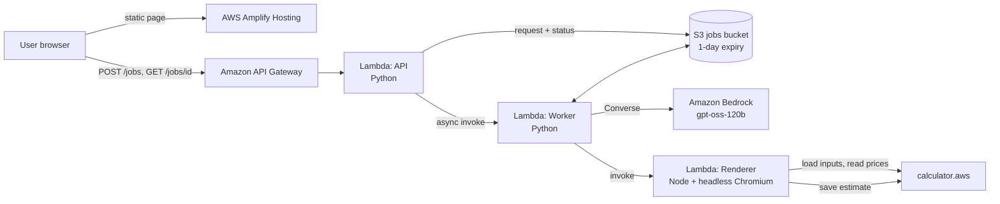

# AWS Estimate Builder

**Turn a sizing sheet or architecture document into a shareable AWS Pricing Calculator estimate — automatically.**

Upload an Excel, CSV, Word, PDF or text file. An LLM on Amazon Bedrock maps every resource to one of the
AWS Pricing Calculator's **400+ services**, fills in the details your document gives, asks only about what is
missing, and returns a public [calculator.aws](https://calculator.aws) link — priced by the AWS Pricing
Calculator itself, so the numbers match what AWS shows.

[](https://github.com/arunprasath403/aws-estimate-builder/actions/workflows/ci.yml)


---

## Why

Building an AWS estimate by hand means re-typing every line of a sizing sheet into the calculator, one service
form at a time. Pre-sales and architecture teams do this daily. This project automates it end to end:

| Manual | AWS Estimate Builder |
|---|---|
| Find each service in the calculator, fill every form | AI matches services and fills fields from your document |
| Easy to mistype units (millions vs. raw counts, GB vs. TB) | Units are validated and corrected, with a visible note |
| 20–60 minutes per estimate | About a minute, plus a review |

## Features

- **402 services, no per-service code** — forms, options, units, defaults and "shown only when" rules are
  generated from the calculator's own published service definitions.
- **Asks instead of guessing** — fields missing from the document become questions; each can be answered or
  explicitly left at the calculator default.
- **Priced by AWS** — a headless browser loads the inputs into calculator.aws, which computes every price;
  4 tabs in parallel price 25 services in about 11 seconds.
- **Guardrails for LLM mistakes** — million/thousand unit fields, TB vs. GB, always-on task counts,
  cost-adding "Yes" add-ons and hidden fields are all checked in code; a $0 result is flagged.
- **Any document** — `.xlsx`, `.csv`, `.docx`, `.pdf`, `.txt`, up to 4 MB.
- **Serverless and cheap** — under 1 cent per estimate for a typical file; ~$0 when idle.

## Architecture



**Flow**

1. **Extract job** — the worker parses the file, then calls Bedrock twice:
   *stage 1* matches each resource to a calculator service code;
   *stage 2* (one call per item, in parallel) fills that service's fields from a compact schema and lists up to
   three price-relevant questions.
2. **Review** — the page renders a form per item from the catalog, highlights questions, hides fields that do
   not apply, and blocks link generation until every question is answered or set to "Use default".
3. **Price / link job** — the worker builds an inputs-only estimate; the renderer opens calculator.aws in
   headless Chromium, places the estimate in the calculator's session storage, lets the calculator compute
   every service, reads the result back and saves it through the calculator's own share endpoint.

Jobs are asynchronous (the page polls) because extraction and pricing can exceed API Gateway's 29-second limit.
See [docs/ARCHITECTURE.md](docs/ARCHITECTURE.md) for design decisions.

## Tech stack

| Layer | Technology |
|---|---|
| Frontend | HTML, CSS, vanilla JavaScript (no build step); hosted on AWS Amplify |
| API & worker | Python 3.12 on AWS Lambda (arm64), `boto3`, `openpyxl`, `pypdf` |
| Renderer | Node.js 22 on AWS Lambda (x86_64), `puppeteer-core`, `@sparticuz/chromium` |
| AI | Amazon Bedrock Converse API, `openai.gpt-oss-120b-1:0` |
| Storage | Amazon S3 (job state, auto-expiring) |
| Infrastructure | AWS CloudFormation, PowerShell deploy script |
| Quality | pytest, cfn-lint, GitHub Actions |

**AWS services:** Amplify Hosting, API Gateway, Lambda (×3), Bedrock, S3, IAM, CloudWatch Logs, AWS Budgets,
CloudFormation.

## Cost

Measured on the deployed stack (us-east-1):

| | 6-service document | 25-service document |
|---|---|---|
| Bedrock (gpt-oss-120b) | $0.004–0.007 | $0.014–0.027 |
| Lambda (renderer, worker, API) | ~$0.002 | ~$0.002 |
| API Gateway, S3, logs | <$0.001 | <$0.001 |
| **Per estimate** | **≈ $0.006–0.009** | **≈ $0.017–0.03** |

Idle cost is a few cents a month. Lambda's permanent free tier covers the Lambda share of roughly 8,000
estimates a month.

## Getting started

### Prerequisites

- AWS account with Amazon Bedrock access to `openai.gpt-oss-120b-1:0` in `us-east-1`
- AWS CLI v2 with a configured profile
- Python 3.12, Node.js 22, PowerShell (Windows) — the deploy script is PowerShell
- Google Chrome (local development only)

### Run locally

```powershell
python -m venv .venv
.venv\Scripts\pip install -r requirements-dev.txt
cd renderer; npm ci; cd ..
$env:AWS_PROFILE = "your-profile"
$env:CHROME_PATH = "C:\Program Files\Google\Chrome\Application\chrome.exe"
.venv\Scripts\python scripts\dev_server.py        # http://localhost:8787
```

Try `samples/sample_broad.txt` (25 services) or `samples/sample_generic.csv`.
Headless run without the UI:

```powershell
.venv\Scripts\python scripts\pipeline_test.py samples\sample_broad.txt --price
```

### Deploy

```powershell
.\scripts\deploy.ps1 -BudgetEmail you@example.com -Profile your-profile
```

This builds the packages, creates the CloudFormation stack and the Amplify app, and prints the app and API URLs.

### Tests

```powershell
.venv\Scripts\pytest -q tests
.venv\Scripts\cfn-lint infra\template.yaml
```

### Refresh the service catalog

When AWS adds or changes calculator services:

```powershell
.venv\Scripts\python catalog\fetch_definitions.py   # downloads ~9 MB into catalog/raw (git-ignored)
.venv\Scripts\python catalog\build_catalog.py       # writes backend/src/data/catalog.json
```

## Project structure

```
backend/src/
  handler.py        API routes and the worker entry point
  jobs.py           async jobs (extract, price, link), S3 or in-memory state
  ai.py             two-stage Bedrock extraction
  forms.py          validation, unit fixes, questions, add-on defaults
  estimate.py       builds calculator estimates (generic + EC2)
  catalog.py        catalog lookup, service matching, show-if evaluation
  parse.py          xlsx / csv / docx / pdf / txt to text
  data/catalog.json generated service catalog
renderer/           headless calculator.aws pricing + save (Lambda, Node)
frontend/           single-page UI
catalog/            catalog download and build scripts
infra/template.yaml CloudFormation stack
scripts/            build, deploy, local dev server, pipeline test
samples/            example input documents
tests/              pytest suite
```

## Security notes

- Uploaded files and job results are stored in a private, encrypted S3 bucket and deleted after one day.
- Each Lambda has its own least-privilege IAM role; Bedrock access is limited to the one model.
- The API is throttled at the stage level. **Add a per-IP limit (for example AWS WAF) before sharing the URL
  publicly**, since every upload invokes Bedrock in your account.
- Estimates are saved on AWS public servers: anyone with an estimate link can view it.

## Limitations

- The calculator's save endpoint and estimate format are not documented, public AWS APIs; they work today and
  may change without notice.
- LLM output can vary between runs. Every value is shown for review before a link is created.
- The Windows/SQL Server dedicated-host bulk-upload workload is not supported (EC2 covers Windows instances).

## Disclaimer

This is an independent project and is not affiliated with, endorsed by, or supported by Amazon Web Services.
"AWS" and related marks are trademarks of Amazon.com, Inc. or its affiliates. Estimates are for planning only;
actual charges depend on your usage and AWS pricing at the time.

## License

[MIT](LICENSE)
