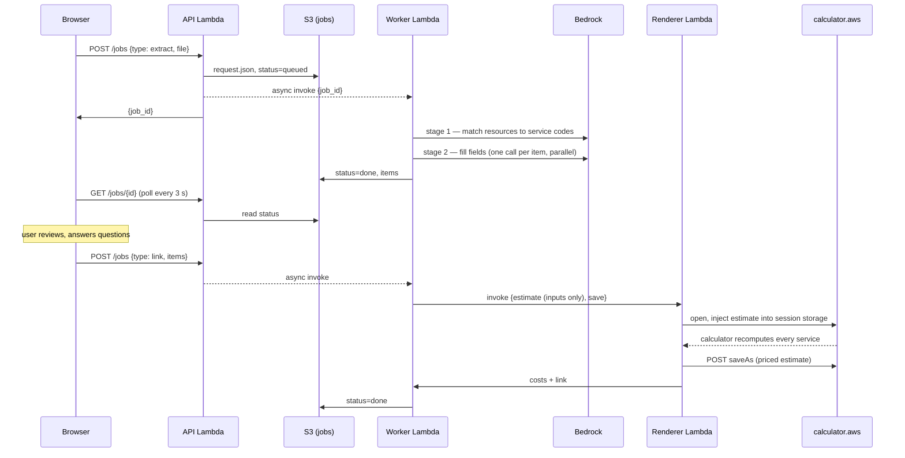

# Architecture and design decisions

## Request lifecycle

## Key decisions

### Let the AWS Pricing Calculator do the pricing
The first version priced EC2, RDS and S3 with the AWS Price List API and hand-written formulas. That does not
scale to 400+ services, and results drifted from the calculator in subtle ways (for example, the calculator
pro-rates EBS by instance utilization). The current design sends only inputs; the calculator's own engine
computes prices in a headless browser. Prices therefore match calculator.aws exactly.

### Generate the catalog from the calculator's definitions
The calculator publishes a manifest and a JSON definition per service (fields, options, units, defaults,
`displayIf` rules). `catalog/build_catalog.py` compresses 442 definitions (~9 MB) into a 1.4 MB catalog used
by both the LLM prompts and the UI. Conditions that only check price availability ("exists meteredUnit") are
dropped; conditions on other inputs become an evaluable `showIf` tree.

### Two-stage LLM extraction
A single prompt cannot carry 400 schemas. Stage 1 sees only a one-line index of all services and returns
service codes; stage 2 sees one service's compact schema per call. Stage 2 calls run in parallel.

### Code guardrails over prompt rules
Prompt instructions reduced but did not eliminate unit mistakes. Each failure seen in testing became a
deterministic check in `forms.py` with a user-visible note:

| Failure seen | Guardrail |
|---|---|
| 30,000,000 entered into a "million per month" field | Convert raw counts when the unit label says million/thousand/billion |
| "1 TB" stored as 1 GB | Match units on their size part (`tb` → `tb\|NA`) |
| Fargate "4 tasks per hour" each running 730 h | When an item runs all month, "Number of…" counts are per month |
| ElastiCache priced at $0 | Fill only safe instance-table columns; let the calculator derive the rest |
| DynamoDB priced at $0 | Include field defaults the calculator's form would have stored |
| RDS Proxy / Database Insights added cost silently | Default "Would you…?" yes/no add-ons to "No" |

### Asynchronous jobs
Extraction (20–40 s) and pricing (10–20 s) exceed API Gateway's 29 s integration limit, so the API stores a
job in S3, invokes the worker asynchronously and the page polls. S3 (with a 1-day lifecycle rule) was chosen
over DynamoDB because uploads can exceed DynamoDB's 400 KB item limit.

### Parallel calculator tabs
The calculator recomputes services sequentially; 25 services took ~190 s in one tab. The renderer splits the
estimate across 4 tabs (each has its own session storage), prices them concurrently and merges the results
(~11 s), then saves the merged estimate.

### EC2 is special-cased
EC2's calculator form uses custom widgets (instance search, workload graphs, pricing-strategy tables) that are
not described declaratively, so EC2 has a small hand-written template and builder.
